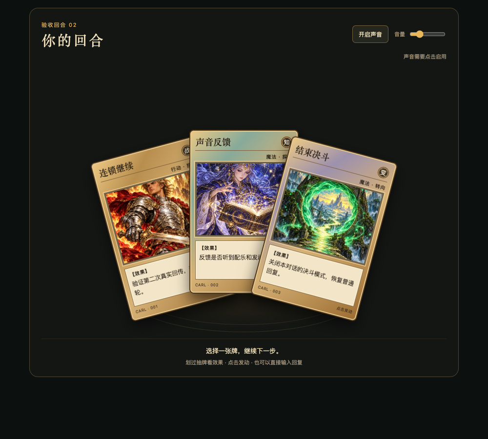
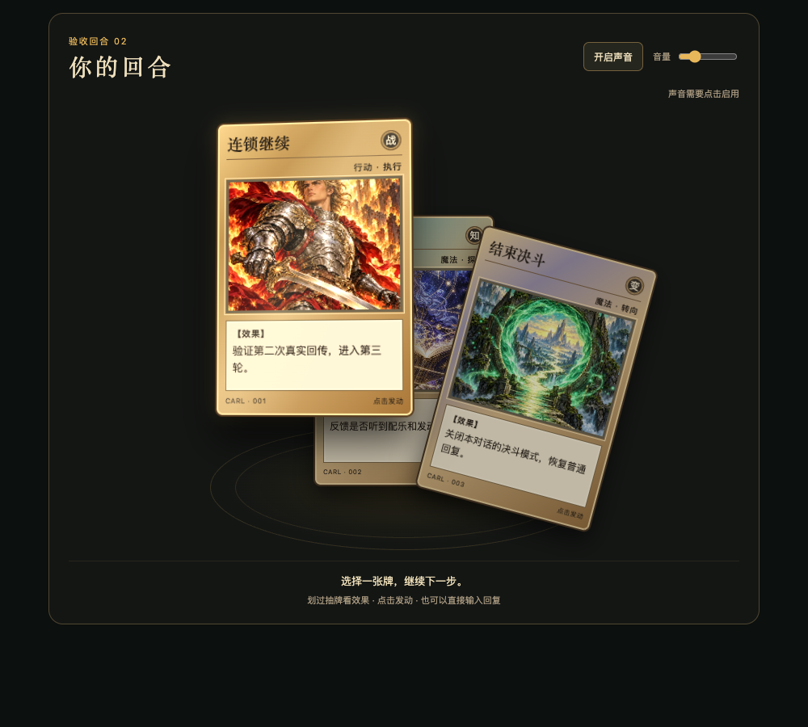

# 0.1.0 验证记录

记录日期：2026-10-26，Asia/Taipei。状态：**预览版，部分真实验收完成**。

自动测试、隔离浏览器检查和真实 Codex 对话分别记录。组件的 Promise 返回或“已请求继续”只证明请求已发起，不证明 AI 收到；浏览器预览也不具备真实 AI 续聊能力。

## 已验证

| 层级 | 结果 | 验证范围 |
| --- | --- | --- |
| Python 单元测试 | 19/19 通过 | 输入类型与长度、中文和特殊字符、脚本转义、插画与音频内联、体积限制、输出不覆盖、模板与 CSS/JS 占位符。 |
| JavaScript 行为测试 | 23/23 通过 | 点击事件内同步请求、重复点击防重、桥接缺失与失败、状态保存异常、恢复后不重发、音频降级及停止竞态。 |
| Skill 格式 | 通过 | Skill 元数据和目录格式检查。 |
| 隔离浏览器检查 | 12/12 通过 | 独立浏览器、沙箱 iframe 和本地 MessageChannel 模拟接收端；消息没有进入真实 AI。包含悬停/聚焦不发消息、点击发送一次、缺桥接、声音失败和状态恢复。 |
| 视觉与窄屏 | 已检查 | 320、360、650、736、1000px 宽度的竖向手牌及预览切换；长卡名、长效果文字；悬停抽牌、前置与收回。受测卡牌最大越界为 0px。 |
| 配乐结构 | 离线检查通过 | 合成序曲约 8 秒，离线波形含淡出；此项不证明真人已听到声音。 |
| 真实 Codex 回传 | 1 次收到 | 选牌用户消息实际进入同一原对话，并继续准备下一轮手牌；尚未组成三轮完整链路。 |
| 普通文字输入 | 通过 | 第一轮真实回传后，用户直接以文字和参考图提出修改，任务正常继续。 |
| 视觉手感反馈 | 已收到正向反馈 | 用户认可当前视觉手感；这属于外观与交互反馈，不代替完整功能验收。 |

以下为隔离浏览器验收场景的真实截图，不是生产对话截图：





## 尚未验证

- 在真实 Codex 中连续完成三轮选牌：每轮都收到正确的选牌消息、AI 执行对应指令并生成下一副手牌。当前完成 1/3。
- 真实关闭模式：关闭当轮不发牌，后续普通请求不再自动发牌；新对话默认关闭。
- 真人试听：实际听到开场与发动音效，确认约 8 秒淡出、音量控制和手动启音体验。
- 不同 Codex 版本、其他设备和其他 AI 客户端的兼容性。现有结果不构成普遍支持承诺。

## 复验方法

在仓库根目录使用 Python 3.10+ 和 Node.js 18+ 运行：

```sh
python3 -m unittest discover -s tests -p test_renderer.py
node --test tests/test_runtime.cjs
python3 scripts/render_hand.py --input examples/hand.json --output work/validation-preview.html --standalone
```

渲染器不会覆盖已有文件；复验时使用新的输出文件名。用浏览器打开独立预览，检查三张竖牌、悬停抽牌与移开收回、键盘 Tab/Enter/Space、声音控制，以及系统减少动态效果设置。普通浏览器应明确显示宿主桥接不可用，并提供完整指令；不要注入假接口后把结果记为真实回传。

在具备 `visualize` 与续聊桥接的 Codex 环境中，另做以下人工验收：

1. 显式调用 Skill 并开启模式，确认完整回复末尾出现三个贴合上下文的真实分支，进度消息不发牌。
2. 悬停与键盘聚焦只预览；点击或按 Enter/Space 才发动。同一副牌快速重复激活应只提交一次。
3. 连续完成三轮。逐轮记录实际收到的卡名、完整指令和 AI 下一轮行为；宿主有确认提示时按正常流程确认。
4. 直接输入普通文字继续，确认任务正常响应且模式保持。
5. 说“关闭决斗模式”，确认当轮和之后的普通请求不再发牌；另开对话，确认默认关闭。
6. 亲自试听开场与发动音效，测试手动启音、调音量、关闭声音；记录可听见、淡出和操作结果。

重新记录日期、浏览器/客户端版本、测试次数和失败项。只有实际消息进入原对话且 AI 按选择继续，才能计入真实选牌轮次；全部人工项目完成前保持“预览版、待完整验收”的状态。
